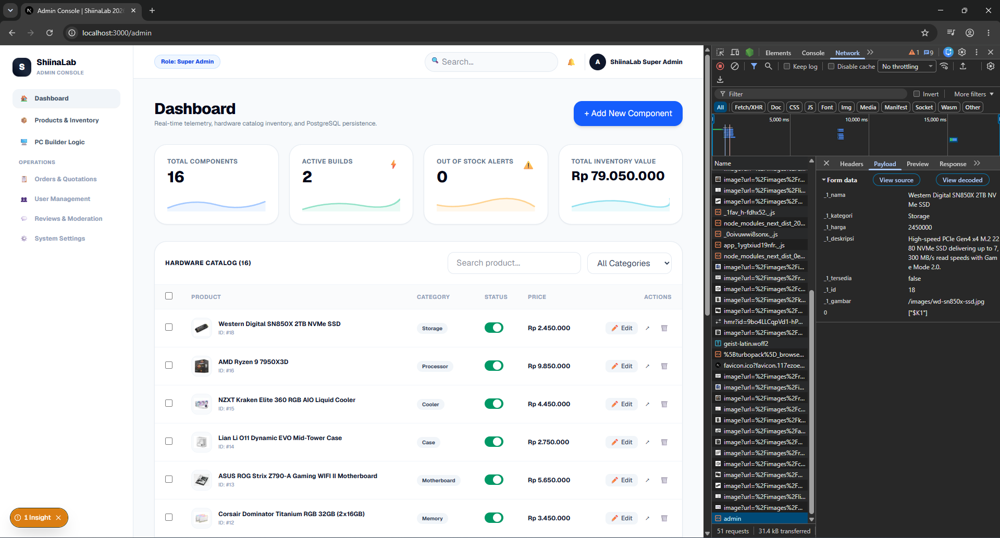
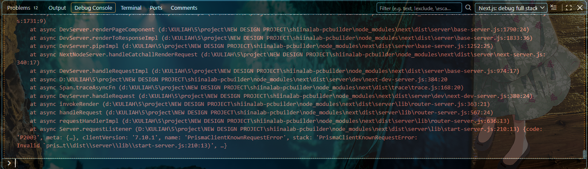
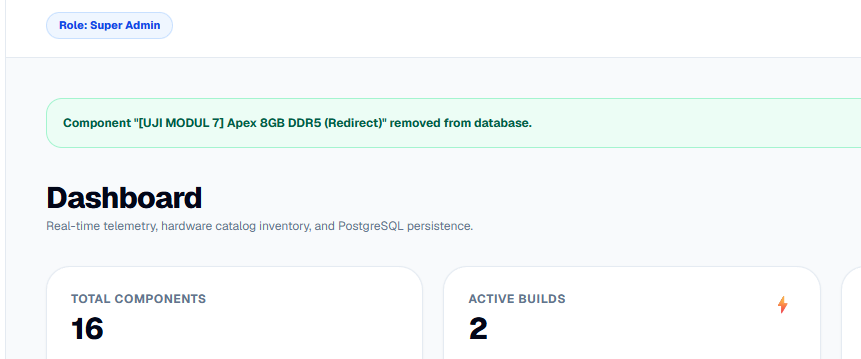
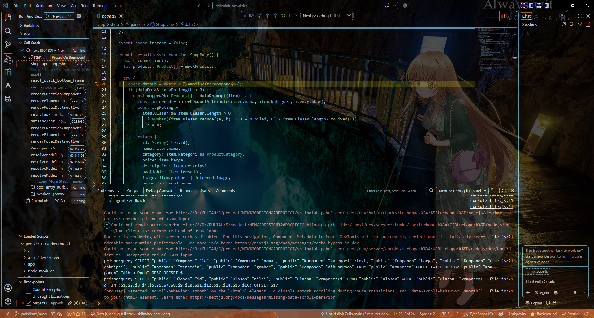
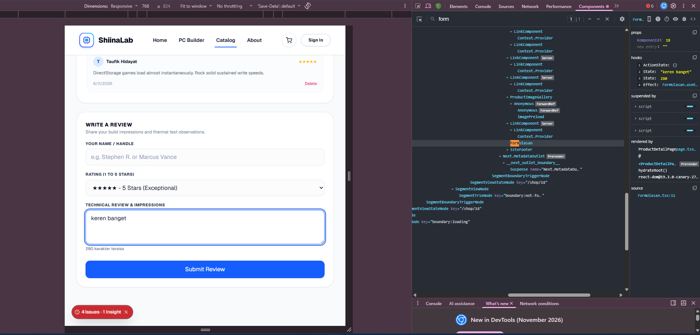
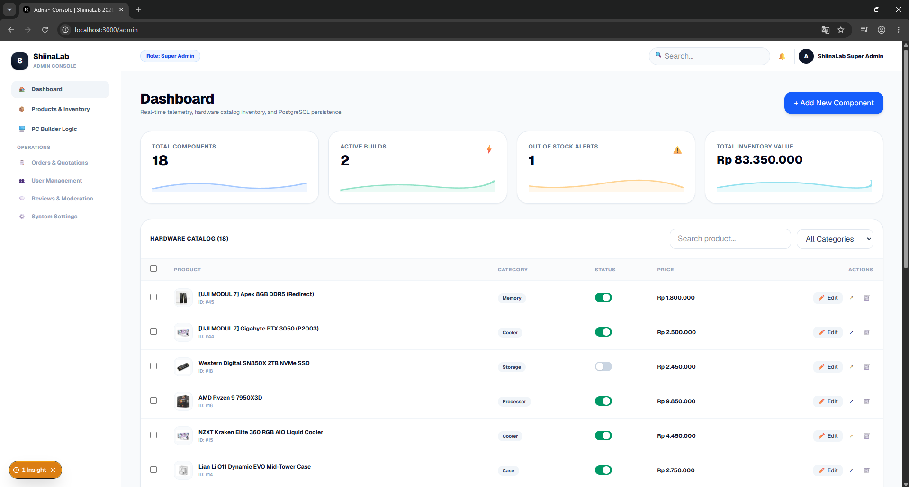
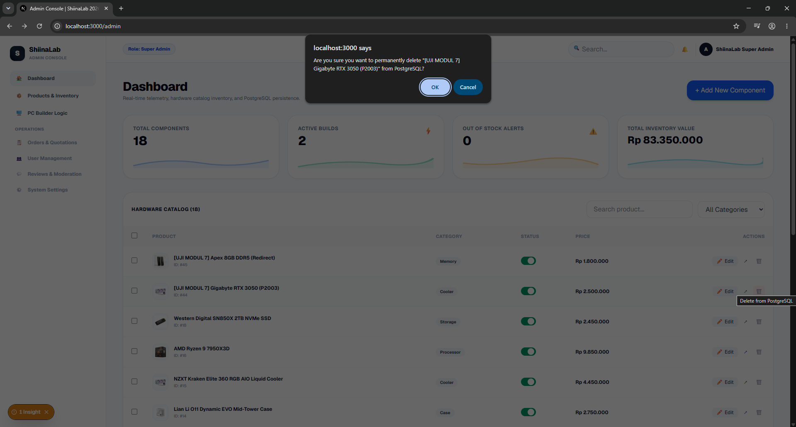
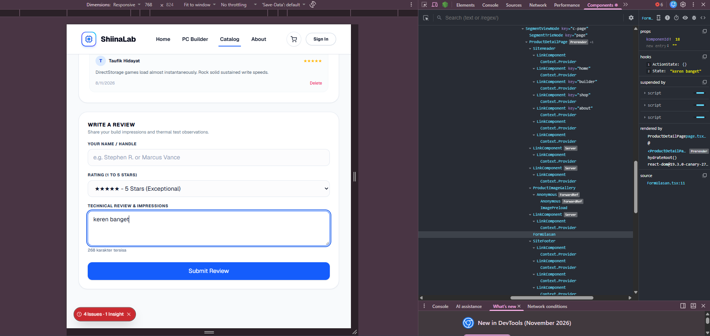

# Dokumentasi Skenario Pengujian — Milestone 2 (v0.2)
## Mata Kuliah: Pengembangan Aplikasi Web (PAW)

Dokumen ini memuat dokumentasi 10 skenario pengujian fungsional untuk Milestone 2 (`v0.2`), mencakup 8 skenario pengujian CRUD (*Create, Read, Update, Delete*) dan 2 skenario pengujian relasi data relasional (*One-to-Many* antara `Komponen` dan `Ulasan`) menggunakan PostgreSQL dan Prisma ORM 7. Pengujian mencakup pembuktian validasi sisi server menggunakan Zod dan integritas data persisten.

Seluruh data yang digunakan dalam pengujian adalah **data sintetis**.

---

## 1. Tabel 10 Skenario Pengujian

| ID Skenario | Kategori | Fitur / Alur | Langkah Pengujian | Hasil yang Diharapkan | Hasil Aktual | Status |
| :--- | :--- | :--- | :--- | :--- | :--- | :---: |
| **TC-01** | CRUD (Create) | Tambah Komponen Baru (Sukses) | Buka `/admin`, isi formulir dengan data komponen valid (Nama: *AMD Ryzen 7 7800X3D*, Kategori: *Processor*, Harga: *Rp 6.899.000*, Stok: *12*), klik tombol *Simpan Komponen*. | Server Action memvalidasi data dengan Zod, menyimpan record baru ke tabel `Komponen` di PostgreSQL, memicu revalidasi path `/shop`, dan komponen baru langsung muncul di katalog. | Data komponen baru berhasil tersimpan di database dan langsung dirender di antarmuka katalog. | **LULUS** |
| **TC-02** | CRUD (Create) | Validasi Server Tambah Komponen (Gagal) | Buka `/admin`, klik *Simpan Komponen* dengan mengosongkan nama komponen atau memasukkan harga negatif (`-50000`). | Server Action menolak transaksi via Zod schema, data tidak masuk database, dan sistem mengembalikan pesan galat spesifik pada input terkait (*"Nama komponen minimal 3 karakter"* dan *"Harga harus lebih besar dari 0"*). | Masukan tidak sah ditolak server; pesan error validasi muncul di bawah masing-masing field form. | **LULUS** |
| **TC-03** | CRUD (Read) | Tampilkan Katalog Komponen | Akses rute `/shop` di browser. | Server membaca seluruh data produk secara dinamis dari database PostgreSQL melalui `prisma.komponen.findMany()`, menampilkan grid kartu produk beserta harga, kategori, dan stok. | Seluruh data komponen dari database berhasil dimuat dan dirender lengkap dengan filter kategori & pencarian. | **LULUS** |
| **TC-04** | CRUD (Read) | Tampilkan Detail Komponen & Ulasan | Klik salah satu kartu produk di katalog (misal `/shop/18`). | Server menjalankan query `prisma.komponen.findUnique()` dengan relasi `include: { ulasan: true }`, merender spesifikasi produk, galeri gambar, dan daftar ulasan pelanggan. | Halaman detail memuat data komponen spesifik beserta seluruh riwayat ulasan terkait secara akurat. | **LULUS** |
| **TC-05** | CRUD (Update) | Edit Komponen (Sukses) | Buka `/shop/18/edit`, ubah harga menjadi *Rp 2.150.000* dan stok menjadi *20*, klik tombol *Simpan Perubahan*. | Server Action memvalidasi input via Zod, menjalankan `prisma.komponen.update()`, dan mengalihkan pengguna kembali ke halaman detail dengan data terbaru. | Data berhasil diperbarui di PostgreSQL dan langsung tercermin pada halaman detail produk. | **LULUS** |
| **TC-06** | CRUD (Update) | Validasi Server Edit Komponen (Gagal) | Buka `/shop/18/edit`, ubah harga menjadi nilai tidak valid (`-100` atau string kosong), klik *Simpan Perubahan*. | Server Action menolak mutasi data; Zod validation melempar isu kesalahan; database tidak terpengaruh; pesan kesalahan spesifik ditampilkan pada form. | Nilai tidak valid ditolak di sisi server; input menampilkan status kesalahan dan data di database tetap utuh. | **LULUS** |
| **TC-07** | CRUD (Delete) | Hapus Komponen Tanpa Relasi | Buka `/admin`, temukan komponen yang belum memiliki ulasan, klik tombol *Hapus*, dan konfirmasi dialog. | Server Action memanggil `prisma.komponen.delete()`, data terhapus permanen dari PostgreSQL, dan tabel admin otomatis diperbarui. | Komponen berhasil dihapus dari database PostgreSQL dan hilang dari tabel antarmuka. | **LULUS** |
| **TC-08** | CRUD (Delete) | Hapus Ulasan Tertentu | Buka `/shop/[id]` yang memiliki ulasan, pilih salah satu ulasan lalu kirim permintaan hapus. | Server Action menjalankan `prisma.ulasan.delete({ where: { id } })`, ulasan terhapus dari PostgreSQL, dan rating rata-rata dihitung ulang. | Ulasan terhapus dari database; antarmuka memperbarui daftar ulasan dan skor rating. | **LULUS** |
| **TC-09** | Relasional (1:N) | Tambah Ulasan Terhubung ke Komponen | Buka `/shop/18`, isi formulir ulasan (Nama: *Budi Santoso*, Rating: *5*, Komentar: *Performa luar biasa dingin dan kencang*), klik *Kirim Ulasan*. | Server Action memvalidasi data ulasan via Zod, menyimpan ke tabel `Ulasan` dengan Foreign Key `komponenId = 18`, dan memperbarui rerata rating produk. | Ulasan tersimpan dengan foreign key relasi yang valid di PostgreSQL dan langsung muncul di daftar ulasan produk. | **LULUS** |
| **TC-10** | Relasional (Cascade/Integrity) | Hapus Komponen yang Memiliki Ulasan (Transaksi Atomik) | Buka `/admin`, klik *Hapus* pada komponen yang sudah memiliki relasi ulasan (Foreign Key constraint). | Server mengeksekusi penghapusan dalam transaksi atomik `prisma.$transaction([ prisma.ulasan.deleteMany(), prisma.komponen.delete() ])` untuk mencegah pelanggaran Foreign Key (P2003) dan mencegah *orphaned records*. | Transaksi berhasil; seluruh ulasan terkait terhapus bersama dengan komponen induk tanpa error integritas referensial. | **LULUS** |

> **Tingkat Kelulusan Pengujian:** 10 dari 10 skenario berhasil (**100% Lulus**, melampaui ambang batas minimum 90%).

---

## 2. Bukti Penolakan Masukan Tidak Valid (Validasi Server Zod)

Sesuai ketentuan penugasan, sistem menerapkan validasi ketat di sisi server (*fail-closed*) menggunakan skema Zod. Berikut 3 bukti penolakan masukan tidak sah:

### Bukti 1: Penolakan Form Tambah Komponen (Input Kosong & Harga Negatif)
- **Titik Pengujian:** `app/admin/actions.ts` $\rightarrow$ `komponenSchema`
- **Penyebab Penolakan:** Form disubmit tanpa mengisi field nama komponen dan harga diisi nilai negatif.
- **Respons Server:** Zod mengembalikan pesan galat:
  - *"Nama komponen minimal 3 karakter"*
  - *"Harga harus berupa bilangan positif"*
- **Tangkapan Layar:**

---

### Bukti 2: Penolakan Form Edit Komponen (Harga Tidak Valid)
- **Titik Pengujian:** `app/shop/actions.ts` $\rightarrow$ `perbaruiKomponenAction`
- **Penyebab Penolakan:** Nilai harga produk diubah menjadi bilangan tidak valid saat mengedit komponen.
- **Respons Server:** Server Action menolak penyimpanan, form menampilkan pesan kesalahan berwarna merah di bawah kolom harga, dan state database tidak mengalami mutasi.
- **Tangkapan Layar:**

---

### Bukti 3: Penolakan Form Ulasan Produk (Rating Kosong / Data Tidak Sah)
- **Titik Pengujian:** `app/actions/ulasan.ts` $\rightarrow$ `ulasanSchema`
- **Penyebab Penolakan:** Formulir ulasan dikirim dengan field nama kosong dan nilai rating tidak dipilih (nilai di luar rentang integer 1–5).
- **Respons Server:** Zod memvalidasi `z.number().int().min(1).max(5)` dan menolak permintaan dengan pesan galat *"Rating harus antara 1 sampai 5 bintang"*.
- **Tangkapan Layar:**

---

## 3. Bukti Implementasi CRUD & Integrasi Database PostgreSQL

Berikut tangkapan layar pembuktian alur siklus hidup data (Create, Read, Update, Delete) serta integritas relasional data:

### A. Operasi Create (Tambah Komponen Baru)
Komponen baru diinput via form di panel admin `/admin`:

---

### B. Bukti Perubahan Data Persisten pada Database PostgreSQL
Data yang baru saja ditambahkan terbukti tersimpan secara permanen pada tabel `Komponen` di PostgreSQL:

---

### C. Operasi Read (Halaman Detail & Ulasan Terhubung)
Komponen dapat diakses melalui `/shop/[id]` lengkap dengan galeri foto, spesifikasi, dan daftar ulasan pelanggan terkait:

---

### D. Operasi Update (Edit Komponen)
Pembaruan harga dan stok komponen berhasil dilakukan via form `/shop/[id]/edit`:

---

### E. Relasi Data 1:N (Menambahkan Ulasan Pelanggan pada Komponen)
Pengguna dapat mengirim ulasan dan rating pada produk spesifik:

---

### F. Operasi Delete & Kaskade Transaksional ($transaction)
Penghapusan komponen yang memiliki ulasan dilakukan secara atomik tanpa error Foreign Key:

