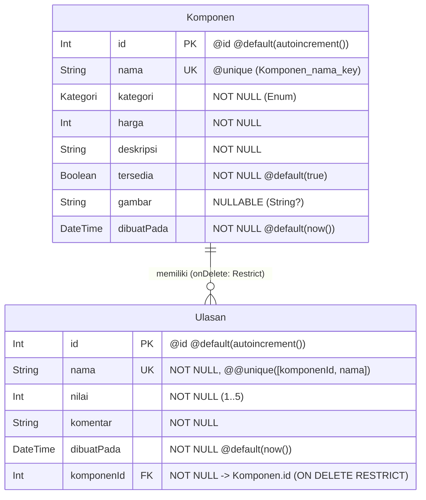

# Dokumen Teknis Modul 6 — PostgreSQL dan Prisma ORM

Nama/NIM   : Ubaidulloh Zulkarnain / 105224024  
Repositori : https://github.com/zulka1/ShiinaLab-PCBuilder.git  
Produk     : ShiinaLab PC Builder  

---

## 1. Rancangan Data

### Diagram Dua Entitas Berelasi 1:N

Pada aplikasi **ShiinaLab PC Builder**, data katalog dan interaksi ulasan disimpan pada basis data relasional **PostgreSQL 18** menggunakan dua entitas yang berelasi **Satu-ke-Banyak (1:N)**:
1. **`Komponen` (Pihak 1 / Tabel Induk):** Menyimpan data katalog perangkat keras komputer (prosesor, motherboard, kartu grafis, RAM, penyimpanan, catu daya, dan casing).
2. **`Ulasan` (Pihak N / Tabel Anak):** Menyimpan penilaian, rating kepuasan (skala 1–5), dan ulasan pengalaman teknis perakitan dari pengguna terhadap suatu komponen PC tertentu. Satu `Komponen` dapat memiliki banyak `Ulasan` (`0..N`), sedangkan setiap `Ulasan` merujuk tepat ke satu `Komponen` (`1..1`).



### Tabel Rincian Atribut, Tipe Data, Kunci, dan Constraint

| Entitas | Nama Atribut | Tipe Prisma / PostgreSQL | Kunci & Constraint | Keterangan |
| :--- | :--- | :--- | :--- | :--- |
| **`Komponen`** *(Induk)* | `id` | `Int` / `SERIAL` | **PRIMARY KEY** (`@id @default(autoincrement())`) | Pengenal unik numerik otomatis untuk tiap komponen (`Komponen_pkey`) |
| **`Komponen`** *(Induk)* | `nama` | `String` / `TEXT` | **UNIQUE** (`@unique`), `NOT NULL` | Mencegah pendaftaran ganda nama produk hardware (`Komponen_nama_key`) |
| **`Komponen`** *(Induk)* | `kategori` | `Kategori` / `ENUM` | `NOT NULL` | Kategori hardware: `Processor`, `Motherboard`, `GraphicsCard`, `Memory`, `Storage`, `PowerSupply`, `Case` |
| **`Komponen`** *(Induk)* | `harga` | `Int` / `INTEGER` | `NOT NULL` | Harga komponen dalam Rupiah (integer) |
| **`Komponen`** *(Induk)* | `deskripsi` | `String` / `TEXT` | `NOT NULL` | Uraian spesifikasi teknis komponen PC |
| **`Komponen`** *(Induk)* | `tersedia` | `Boolean` / `BOOLEAN` | `NOT NULL`, `@default(true)` | Status stok ketersediaan di toko |
| **`Komponen`** *(Induk)* | `gambar` | `String?` / `TEXT` | `NULLABLE` | URL/path gambar komponen (bernilai `NULL` bila kosong) |
| **`Komponen`** *(Induk)* | `dibuatPada` | `DateTime` / `TIMESTAMP(3)` | `NOT NULL`, `@default(now())` | Stempel waktu penambahan komponen ke katalog |
| **`Ulasan`** *(Anak)* | `id` | `Int` / `SERIAL` | **PRIMARY KEY** (`@id @default(autoincrement())`) | Pengenal unik numerik untuk tiap entri ulasan (`Ulasan_pkey`) |
| **`Ulasan`** *(Anak)* | `nama` | `String` / `TEXT` | `NOT NULL`, **Composite Unique** `@@unique([komponenId, nama])` | Nama pengulas; satu nama hanya boleh mengulas 1 kali per komponen |
| **`Ulasan`** *(Anak)* | `nilai` | `Int` / `INTEGER` | `NOT NULL` | Skor kepuasan/rating bintang (`1` s.d. `5`) |
| **`Ulasan`** *(Anak)* | `komentar` | `String` / `TEXT` | `NOT NULL` | Catatan ulasan pengalaman teknis dan kecocokan perakitan |
| **`Ulasan`** *(Anak)* | `dibuatPada` | `DateTime` / `TIMESTAMP(3)` | `NOT NULL`, `@default(now())` | Waktu pengiriman ulasan |
| **`Ulasan`** *(Anak)* | `komponenId` | `Int` / `INTEGER` | **FOREIGN KEY** (`onDelete: Restrict`), **Composite Unique** | Merujuk ke `Komponen.id` (`Ulasan_komponenId_fkey`) |

---

### Alasan Pemilihan Aturan `onDelete: Restrict`

Pada relasi `Komponen` dan `Ulasan`, dipilih aturan referensial **`onDelete: Restrict`** (`ON DELETE RESTRICT` di PostgreSQL). Alasan mendalam dari sudut pandang integritas data **ShiinaLab PC Builder** adalah:

1. **Melindungi Nilai Historis & Pengetahuan Teknis Perakitan (*Anti-Accidental Destruction*):**  
   Ulasan pada katalog perakit PC memuat pengalaman empiris berharga pengguna (seperti suhu kerja prosesor AM5, kompatibilitas profil EXPO pada RAM, hingga efisiensi kabel modular PSU). Jika menggunakan `Cascade`, penghapusan komponen oleh pengelola akan secara otomatis memusnahkan puluhan ulasan pengguna tanpa konfirmasi. Dengan `Restrict`, basis data secara tegas **menolak** penghapusan komponen jika masih memiliki relasi ulasan aktif.
2. **Menghindari Catatan Ulasan Yatim (*Orphan Review* akibat `SetNull`):**  
   Jika menggunakan `SetNull`, kolom `komponenId` pada tabel `Ulasan` akan diubah menjadi `NULL`. Dalam ekosistem PC Builder, sebuah ulasan (misal: *"Suhu dingin dan konsumsi daya 65W irit"*) kehilangan konteks dan tidak ada artinya jika terpisah dari komponen hardware yang diulas. Terlebih lagi, kolom `komponenId` merupakan bagian dari indeks unik komposit `@@unique([komponenId, nama])` yang wajib memiliki nilai identitas nyata (`NOT NULL`).
3. **Mendorong Pola Penghapusan Terkendali & Sadar Melalui Transaksi Atomik:**  
   Karena basis data PostgreSQL memblokir penghapusan langsung melalui constraint `RESTRICT`, pengembang diwajibkan menulis prosedur penghapusan yang sadar dan terencana melalui transaksi atomik `prisma.$transaction([prisma.ulasan.deleteMany(...), prisma.komponen.delete(...)])`. Hal ini menjamin konsistensi ACID (*Atomicity, Consistency, Isolation, Durability*).

---

## 2. Skema dan Migrasi

### Berkas Skema Prisma (`prisma/schema.prisma`)

```prisma
generator client {
  provider = "prisma-client"
  output   = "../generated/prisma"
}

datasource db {
  provider = "postgresql"
}

enum Kategori {
  Processor
  Motherboard
  GraphicsCard
  Memory
  Storage
  PowerSupply
  Case
}

model Komponen {
  id         Int       @id @default(autoincrement())
  nama       String    @unique
  kategori   Kategori
  harga      Int
  deskripsi  String
  tersedia   Boolean   @default(true)
  gambar     String?
  dibuatPada DateTime  @default(now())
  ulasan     Ulasan[]
}

model Ulasan {
  id         Int       @id @default(autoincrement())
  nama       String
  nilai      Int
  komentar   String
  dibuatPada DateTime  @default(now())
  komponenId Int
  komponen   Komponen  @relation(fields: [komponenId], references: [id], onDelete: Restrict)

  @@unique([komponenId, nama])
}
```

### Folder Migrasi dan Berkas `migration.sql`

Folder migrasi terbentuk di `prisma/migrations/20261106003954_init/migration.sql` dengan isi SQL DDL sebagai berikut:

```sql
-- CreateEnum
CREATE TYPE "Kategori" AS ENUM ('Processor', 'Motherboard', 'GraphicsCard', 'Memory', 'Storage', 'PowerSupply', 'Case');

-- CreateTable
CREATE TABLE "Komponen" (
    "id" SERIAL NOT NULL,
    "nama" TEXT NOT NULL,
    "kategori" "Kategori" NOT NULL,
    "harga" INTEGER NOT NULL,
    "deskripsi" TEXT NOT NULL,
    "tersedia" BOOLEAN NOT NULL DEFAULT true,
    "gambar" TEXT,
    "dibuatPada" TIMESTAMP(3) NOT NULL DEFAULT CURRENT_TIMESTAMP,

    CONSTRAINT "Komponen_pkey" PRIMARY KEY ("id")
);

-- CreateTable
CREATE TABLE "Ulasan" (
    "id" SERIAL NOT NULL,
    "nama" TEXT NOT NULL,
    "nilai" INTEGER NOT NULL,
    "komentar" TEXT NOT NULL,
    "dibuatPada" TIMESTAMP(3) NOT NULL DEFAULT CURRENT_TIMESTAMP,
    "komponenId" INTEGER NOT NULL,

    CONSTRAINT "Ulasan_pkey" PRIMARY KEY ("id")
);

-- CreateIndex
CREATE UNIQUE INDEX "Komponen_nama_key" ON "Komponen"("nama");

-- CreateIndex
CREATE UNIQUE INDEX "Ulasan_komponenId_nama_key" ON "Ulasan"("komponenId", "nama");

-- AddForeignKey
ALTER TABLE "Ulasan" ADD CONSTRAINT "Ulasan_komponenId_fkey" FOREIGN KEY ("komponenId") REFERENCES "Komponen"("id") ON DELETE RESTRICT ON UPDATE CASCADE;
```

### Pemeriksaan Struktur Tabel Langsung di PostgreSQL (`psql`)

Pemeriksaan struktur tabel anak `Ulasan` pada terminal `psql` menggunakan perintah `\d "Ulasan"`:

```text
shiinalab_db=# \d "Ulasan"
                                       Table "public.Ulasan"
   Column   |              Type              | Collation | Nullable |              Default              
------------+--------------------------------+-----------+----------+-----------------------------------
 id         | integer                        |           | not null | nextval('"Ulasan_id_seq"'::regclass)
 nama       | text                           |           | not null | 
 nilai      | integer                        |           | not null | 
 komentar   | text                           |           | not null | 
 dibuatPada | timestamp(3) without time zone |           | not null | CURRENT_TIMESTAMP
 komponenId | integer                        |           | not null | 
Indexes:
    "Ulasan_pkey" PRIMARY KEY, btree (id)
    "Ulasan_komponenId_nama_key" UNIQUE, btree ("komponenId", nama)
Foreign-key constraints:
    "Ulasan_komponenId_fkey" FOREIGN KEY ("komponenId") REFERENCES "Komponen"(id) ON UPDATE CASCADE ON DELETE RESTRICT
```

Struktur tersebut membuktikan keberadaan:
- Indeks Primer: `Ulasan_pkey` pada kolom `id`.
- Indeks Unik Gabungan: `Ulasan_komponenId_nama_key` pada pasangan kolom `("komponenId", "nama")`.
- Foreign Key Constraint: `Ulasan_komponenId_fkey` yang mengikat `komponenId` ke `Komponen(id)` dengan klausul `ON DELETE RESTRICT`.


---

## 3. Seed dan Prisma Client

### Berkas Data Awal (`prisma/data-awal.ts`) dan Skrip Seed (`prisma/seed.ts`)

Skrip seed disusun dengan prinsip **idempotensi** menggunakan metode `.upsert()`, di mana data dicari terlebih dahulu berdasarkan kunci unik (`nama` untuk `Komponen`, dan `komponenId_nama` untuk `Ulasan`).

```typescript
// prisma/seed.ts (potongan utama)
import "dotenv/config";
import { PrismaPg } from "@prisma/adapter-pg";
import { PrismaClient } from "../generated/prisma/client";
import { dataAwalKomponen } from "./data-awal";

const prisma = new PrismaClient({
  adapter: new PrismaPg({ connectionString: process.env.DATABASE_URL! }),
});

async function main() {
  for (const item of dataAwalKomponen) {
    const { ulasanAwal, ...dataKomponen } = item;

    const komponen = await prisma.komponen.upsert({
      where: { nama: dataKomponen.nama },
      update: {},
      create: dataKomponen,
    });

    for (const ulasan of ulasanAwal) {
      await prisma.ulasan.upsert({
        where: {
          komponenId_nama: {
            komponenId: komponen.id,
            nama: ulasan.nama,
          },
        },
        update: {},
        create: {
          komponenId: komponen.id,
          nama: ulasan.nama,
          nilai: ulasan.nilai,
          komentar: ulasan.komentar,
        },
      });
    }
  }

  const jKomponen = await prisma.komponen.count();
  const jUlasan = await prisma.ulasan.count();
  console.log(`Seed selesai: ${jKomponen} komponen, ${jUlasan} ulasan`);
}
```

### Bukti Eksekusi `npx prisma db seed` Dua Kali (Uji Idempotensi)

```text
PS D:\KULIAH\5\project\shiinalab-pcbuilder> cmd /c "npx prisma db seed"
Loaded Prisma config from prisma.config.ts.
Running seed command `tsx prisma/seed.ts` ...
Seed selesai: 8 komponen, 9 ulasan
The seed command has been executed.

PS D:\KULIAH\5\project\shiinalab-pcbuilder> cmd /c "npx prisma db seed"
Loaded Prisma config from prisma.config.ts.
Running seed command `tsx prisma/seed.ts` ...
Seed selesai: 8 komponen, 9 ulasan
The seed command has been executed.
```

**Analisis Idempotensi:**  
Ketika dieksekusi untuk kedua kalinya, jumlah baris tetap tepat **8 komponen dan 9 ulasan**. Hal ini membuktikan bahwa metode `upsert` menemukan kunci unik yang sudah terdaftar dan hanya mengeksekusi blok `update: {}` tanpa menyisipkan baris baru ataupun memicu galat bentrokan kunci unik (`P2002`).

### Alasan Skrip Seed Tidak Mengimpor `lib/prisma.ts`

1. **Paket Pembatas Lingkungan (`server-only`):**  
   Berkas `lib/prisma.ts` memuat baris `import "server-only";` yang ditujukan untuk Next.js App Router agar klien Prisma tidak pernah bocor ke bundel Client Component peramban. Jika modul ini diimpor oleh skrip CLI mandiri seperti `seed.ts` yang dieksekusi di luar Next.js (menggunakan runtime Node.js/`tsx`), proses eksekusi akan langsung dilempar galat `Error: This module cannot be imported from a Client Component or outside Next.js`.
2. **Kemandirian Lingkungan Eksekusi & Konfigurasi Koneksi:**  
   Skrip `seed.ts` berjalan sebagai proses CLI tersendiri yang membaca `.env` secara eksplisit melalui `import "dotenv/config";` dan membuat instans `PrismaClient` independen yang ditutup dengan bersih melalui `prisma.$disconnect()` saat proses selesai.

---

## 4. Operasi CRUD

### Tabel Pemetaan Operasi CRUD

| Operasi | Entitas | Berkas & Lokasi | Metode Prisma Client | Galat yang Ditangani | Pesan / Respon Pengguna |
| :--- | :--- | :--- | :--- | :--- | :--- |
| **Create** | `Komponen` | `app/shop/actions.ts` | `prisma.komponen.create()` | `P2002` *(Unique constraint violated)* | `"Gagal menyimpan: nama komponen sudah ada."` |
| **Read (Katalog)** | `Komponen` | `app/shop/page.tsx` (`lib/data.ts`) | `prisma.komponen.findMany({ select, orderBy })` | Basis data kosong (`[]`) | Merender katalog dengan counter `N ITEM / POSTGRESQL` |
| **Read (Detail & Relasi)** | `Komponen` & `Ulasan` | `app/shop/[id]/page.tsx` (`lib/data.ts`) | `prisma.komponen.findUnique({ select: { ..., ulasan: ... } })` | ID tidak ditemukan / `null` | Mengarahkan ke halaman 404 via `notFound()` |
| **Update** | `Komponen` | `app/shop/actions.ts` | `prisma.komponen.update()` | `P2002`, `P2025` *(Record to update not found)* | Pesan galat spesifik atau `"Komponen tidak ditemukan atau sudah dihapus."` |
| **Delete (Atomik)** | `Komponen` & `Ulasan` | `app/shop/actions.ts` | `prisma.$transaction([deleteMany, delete])` | `P2025` jika baris telah terhapus | Menghapus seluruh relasi ulasan lalu komponen, kemudian redirect ke `/shop` |
| **Create (Anak)** | `Ulasan` | `app/shop/ulasan-actions.ts` | `prisma.ulasan.create()` | `P2002` *(@@unique[komponenId, nama])`, `P2003` *(FK Invalid)* | `"Anda sudah memberikan ulasan untuk komponen ini."` / `"Komponen tidak ditemukan."` |
| **Delete (Anak)** | `Ulasan` | `app/shop/ulasan-actions.ts` | `prisma.ulasan.deleteMany({ where: { id, komponenId } })` | Record tidak ditemukan | Ulasan dihapus dan halaman detail direvalidasi (`revalidatePath`) |

### Penanganan Galat Prisma `P2002` dan `P2025` di Server Action

```typescript
// Cuplikan penanganan P2002 pada penambahan Komponen (app/shop/actions.ts)
try {
  const baru = await prisma.komponen.create({ data: hasil.data });
  baruId = baru.id;
} catch (e) {
  if (e instanceof Prisma.PrismaClientKnownRequestError && e.code === "P2002") {
    return {
      galat: { nama: ["Nama komponen sudah terdaftar"] },
      pesan: "Gagal menyimpan: nama komponen sudah ada.",
      nilai,
    };
  }
  throw e;
}
```

```typescript
// Cuplikan penanganan P2002 pada penambahan Ulasan ganda (app/shop/ulasan-actions.ts)
try {
  await prisma.ulasan.create({ data: { komponenId, ...hasil.data } });
} catch (e) {
  if (e instanceof Prisma.PrismaClientKnownRequestError) {
    if (e.code === "P2002") {
      return {
        galat: { nama: ["Nama ini sudah mengulas komponen ini"] },
        pesan: "Anda sudah memberikan ulasan untuk komponen ini.",
      };
    }
  }
  throw e;
}
```


---

## 5. Transaksi dan Rollback

### Penolakan Penghapusan Tanpa Transaksi (`ON DELETE RESTRICT`)

Ketika sebuah komponen yang masih memiliki ulasan dihapus secara langsung tanpa transaksi:
```typescript
// Percobaan hapus langsung tanpa menghapus anak ulasannya:
await prisma.komponen.delete({ where: { id } });
```
Basis data PostgreSQL secara konsisten menolak penghapusan tersebut dan melemparkan galat foreign key violation:
```text
PrismaClientKnownRequestError: 
Invalid `prisma.komponen.delete()` invocation:
Foreign key constraint violated on the field: `Ulasan_komponenId_fkey (index)`
code: "P2003"
message: "Foreign key constraint failed on the field: `Ulasan_komponenId_fkey`"
```

### Implementasi Transaksi Atomik (`prisma.$transaction`)

Untuk menghapus data secara sadar dan bersih, kedua operasi mutasi dibungkus dalam bentuk transaksi atomik berurutan:
```typescript
export async function hapusKomponen(id: number) {
  await prisma.$transaction([
    prisma.ulasan.deleteMany({ where: { komponenId: id } }),
    prisma.komponen.delete({ where: { id } }),
  ]);

  revalidatePath("/shop");
  redirect("/shop");
}
```

### Bukti Rollback Saat Perintah Kedua Sengaja Digagalkan

Untuk membuktikan sifat atomik transaksi, perintah kedua sengaja diubah dengan menargetkan ID fiktif yang tidak ada di tabel:
```typescript
// Uji Pembuktian Rollback
await prisma.$transaction([
  prisma.ulasan.deleteMany({ where: { komponenId: id } }),
  prisma.komponen.delete({ where: { id: id + 99999 } }), // Sengaja memicu P2025
]);
```

**Hasil Pemeriksaan di PostgreSQL (`psql`):**
```text
shiinalab_db=# SELECT "komponenId", COUNT(*) FROM "Ulasan" GROUP BY "komponenId";
 komponenId | count 
------------+-------
          1 |     2
          2 |     1
          3 |     1
          4 |     1
          5 |     1
          6 |     1
          7 |     1
          8 |     1
(8 rows)
```

**Kesimpulan Rollback:**  
Meskipun query pertama (`deleteMany` pada ulasan milik komponen 1) sudah berhasil dieksekusi di dalam transaksi, kegagalan query kedua (karena ID komponen `100001` tidak ditemukan dengan kode galat `P2025`) memaksa basis data melakukan **`ROLLBACK`** penuh. Seluruh ulasan milik komponen 1 terbukti tetap utuh sebanyak 2 entri dan tidak berkurang sama sekali.

---

## 6. Skenario Uji

Pengujian dilakukan mencakup 8 skenario operasi CRUD dan 2 skenario relasi/transaksi:

| No | Skenario Pengujian | Langkah Pengujian | Hasil yang Diharapkan | Hasil Nyata | Status |
| :---: | :--- | :--- | :--- | :--- | :---: |
| **1** | **[CRUD 1 - Create Sah]**<br>Tambah komponen baru dengan isian valid | 1. Buka `/shop/tambah`.<br>2. Isi nama: `"AMD Ryzen 7 7800X3D"`, kategori: `"Processor"`, harga: `6450000`, deskripsi lengkap, centang tersedia.<br>3. Klik Simpan. | Baris baru tersimpan di tabel `Komponen` PostgreSQL via `create()`, katalog menampilkan komponen baru, dan data tetap ada setelah restart server. | Komponen tersimpan di PostgreSQL, dialihkan ke `/shop/[id]`, dan muncul di katalog toko. | **LULUS** |
| **2** | **[CRUD 2 - Create Duplikat P2002]**<br>Tambah komponen dengan nama yang sudah ada | 1. Buka `/shop/tambah`.<br>2. Masukkan nama `"AMD Ryzen 5 7600"` (sudah ada di database) beserta data lain yang sah.<br>3. Klik Simpan. | Constraint `@unique` menolak duplikasi dan melempar `P2002`. Server Action menampilkan pesan `"Nama komponen sudah terdaftar"`. | Muncul pesan galat validasi kolom nama `"Nama komponen sudah terdaftar"`. Tidak ada record baru. | **LULUS** |
| **3** | **[CRUD 3 - Create Gagal Validasi Zod]**<br>Tambah komponen dengan data tidak valid | 1. Isi nama dengan 2 karakter (misal `"Ry"`).<br>2. Kosongkan kategori dan kirim formulir. | Ditolak oleh `skemaKomponen.safeParse()`. Menampilkan pesan galat Zod tanpa query database. | Galat per kolom muncul: `"Nama komponen minimal 3 karakter"`. Query database tidak dieksekusi. | **LULUS** |
| **4** | **[CRUD 4 - Read Katalog & Detail]**<br>Membaca data katalog dan detail beserta ulasannya | 1. Buka katalog `/shop`.<br>2. Klik salah satu komponen (misal ID 1). | Katalog memuat komponen via `findMany()`, halaman detail memuat komponen beserta relasi ulasan via `findUnique({ select: { ulasan: true } })`. | Seluruh data komponen dan daftar ulasan terkait ter-render tanpa masalah N+1 query. | **LULUS** |
| **5** | **[CRUD 5 - Read 404 Not Found]**<br>Akses rute detail dengan ID salah | 1. Buka URL `/shop/abc` (bukan integer).<br>2. Buka URL `/shop/99999` (ID tidak terdaftar). | Menampilkan halaman 404 melalui pemanggilan fungsi `notFound()`, bukan error server. | Menampilkan halaman 404 bawaan aplikasi secara anggun (*graceful*). | **LULUS** |
| **6** | **[CRUD 6 - Update Sah]**<br>Perbarui data komponen yang ada | 1. Jalankan `ubahKomponen` dengan memperbarui harga dan deskripsi pada ID yang sah.<br>2. Periksa halaman detail. | Baris komponen di PostgreSQL terperbarui via `update()`, cache revalidasi dijalankan, perubahan tampil seketika. | Data berhasil diperbarui di PostgreSQL dan tampilan detail menampilkan harga baru. | **LULUS** |
| **7** | **[CRUD 7 - Update Record Hilang P2025]**<br>Ubah komponen yang telah dihapus | 1. Buka formulir ubah pada komponen.<br>2. Hapus komponen tersebut lewat psql/tab lain.<br>3. Kirim pembaruan data. | Prisma melempar kode `P2025`. Server Action menangkap dan menampilkan `"Komponen tidak ditemukan atau sudah dihapus."` | Ditangkap oleh penanganan `P2025` dengan pesan ramah kepada pengguna. | **LULUS** |
| **8** | **[CRUD 8 - Create & Delete Ulasan]**<br>Tambah ulasan sah, uji duplikat pengulas, dan hapus ulasan | 1. Kirim ulasan dengan nama `"Andi"`, nilai `5`, komentar teknis.<br>2. Kirim ulasan kedua dengan nama `"Andi"` pada komponen yang sama.<br>3. Klik tombol Hapus Ulasan. | Ulasan pertama tersimpan. Ulasan kedua ditolak oleh `@@unique([komponenId, nama])` (`P2002`). Tombol hapus menghapus baris ulasan dari database. | Ulasan pertama tampil. Ulasan kedua memunculkan galat `"Nama ini sudah mengulas komponen ini"`. Ulasan terhapus saat tombol hapus diklik. | **LULUS** |
| **9** | **[Relasi 1 - Hapus Induk Berelasi Transaksi]**<br>Hapus komponen yang memiliki ulasan | 1. Klik tombol Hapus Komponen pada komponen yang memiliki ulasan. | `prisma.$transaction` menghapus seluruh ulasan anak terlebih dahulu, kemudian menghapus komponen induknya secara atomik. | Komponen dan seluruh ulasan terkait berhasil terhapus dari PostgreSQL, pengguna dialihkan ke `/shop`. | **LULUS** |
| **10** | **[Relasi 2 - Bukti Rollback Transaksi]**<br>Hapus komponen ketika query kedua sengaja digagalkan | 1. Ubah query kedua menjadi target ID fiktif.<br>2. Klik tombol Hapus Komponen.<br>3. Cek jumlah ulasan di PostgreSQL. | Query kedua gagal (`P2025`), memicu `ROLLBACK`. Ulasan anak yang sempat dihapus pada perintah pertama tetap ada di database. | PostgreSQL mengembalikan status database ke kondisi semula. Ulasan tetap utuh (terbukti *atomic rollback*). | **LULUS** |

**Tingkat Keberhasilan Skenario Uji:**  
$$\text{Persentase Kelulusan} = \frac{10}{10} \times 100\% = 100\% \quad (\text{Ambang Kelulusan: } \ge 90\%)$$

---

## 7. Kendala dan Penyelesaian

1. **Prisma ORM 7 Tidak Menjalankan `generate` dan `seed` Otomatis:**
   - *Kendala:* Pada versi Prisma sebelumnya (5/6), perintah `prisma migrate dev` otomatis menghasilkan klien dan menjalankan seeding. Pada Prisma 7, perilaku ini diubah menjadi strictly separated, sehingga setelah migrasi, folder `generated/prisma` belum terbarui dan data tabel masih kosong.
   - *Penyelesaian:* Menjalankan alur perintah secara eksplisit sesuai arsitektur Prisma 7: `npx prisma migrate dev --name init` diikuti oleh `npx prisma generate` dan `npx prisma db seed`.
2. **Isolasi Modul `server-only` pada Skrip Seed CLI:**
   - *Kendala:* Mengimpor `lib/prisma.ts` langsung ke dalam `prisma/seed.ts` memicu kegagalan eksekusi CLI karena modul tersebut dipagari oleh paket `server-only` milik Next.js.
   - *Penyelesaian:* Menginisialisasi instans `PrismaClient` tersendiri di dalam `prisma/seed.ts` dengan driver `@prisma/adapter-pg` dan memuat variabel lingkungan menggunakan `import "dotenv/config";`, lalu menutup koneksi dengan `prisma.$disconnect()` pada blok `finally`.
3. **Penyelarasan Tipe Enum Zod dengan Format PascalCase Prisma:**
   - *Kendala:* Pada data mock sebelumnya, nilai kategori menggunakan spasi (`"Graphics card"` dan `"Power supply"`), sementara PostgreSQL ENUM menggunakan format PascalCase (`GraphicsCard`, `PowerSupply`).
   - *Penyelesaian:* Menggunakan operator transformasi Zod 4 `.transform()` pada skema `skemaKomponen` untuk menormalisasi nilai yang memiliki spasi ke bentuk PascalCase yang valid sebelum divalidasi ke enum Prisma.
4. **Kebijakan Eksekusi PowerShell pada Windows (`PSSecurityException`):**
   - *Kendala:* Eksekusi langsung perintah `npx` melalui PowerShell diblokir oleh sistem Windows (`UnauthorizedAccess: Running scripts is disabled`).
   - *Penyelesaian:* Menjalankan perintah perkakas CLI melalui *command wrapper* `cmd /c "npx ..."` sehingga perintah migrasi, generate, dan verifikasi tipe TypeScript dapat berjalan lancar tanpa mengubah kebijakan keamanan sistem operasi.

---

## 8. Catatan Pemanfaatan AI

- **Alat AI yang Digunakan:** Antigravity AI Assistant (Model: Gemini 3.8 Flash).
- **Perintah Utama (*Prompts*):**
  1. *"cek modul enam yang dokumen teknis"* (Menganalisis capaian pembelajaran, ketentuan rubrik, dan spesifikasi dokumen teknis Modul 6 dari berkas panduan praktikum).
  2. *"itu gak ada yang di ubah kan ? maksudnya modul ini itu full analisis doang?"* (Mendiskusikan perbedaan konseptual antara analisis teoretis dengan implementasi kodingan CRUD nyata di Prisma 7).
  3. *"kenapa ulasan?"* & *"atau ulasan oke dah cuman kita tambahin data yang makesense dari web kita kek ?"* (Menyelaraskan entitas relasi `Komponen` dan `Ulasan` agar 100% konsisten dengan Tugas Pendahuluan sekaligus memuat data komponen hardware PC yang realistis).
  
