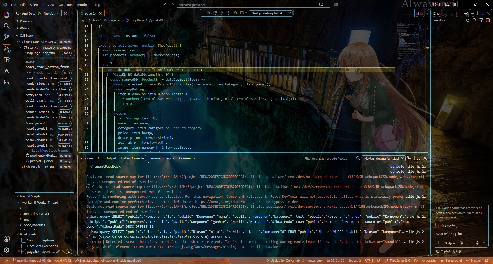
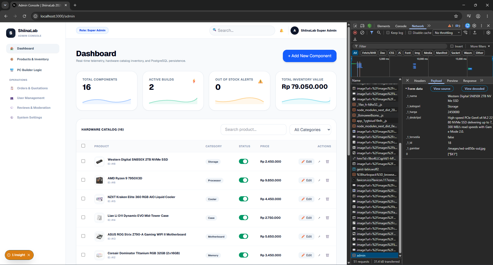
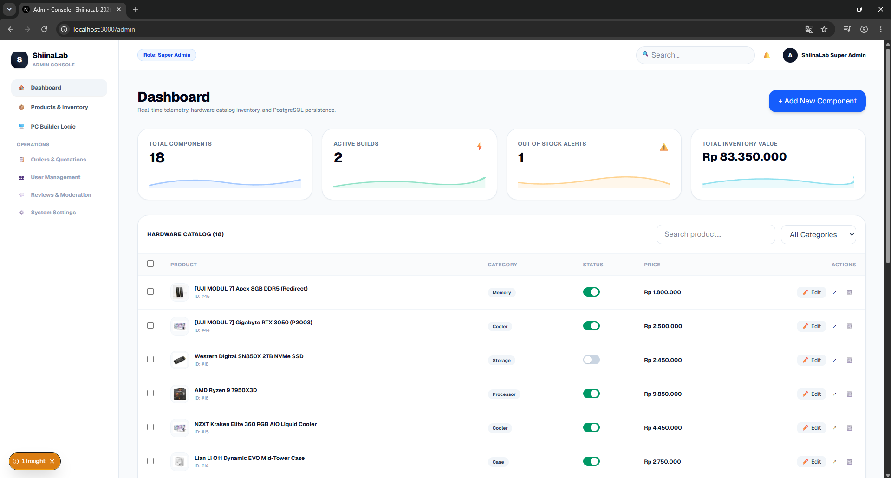
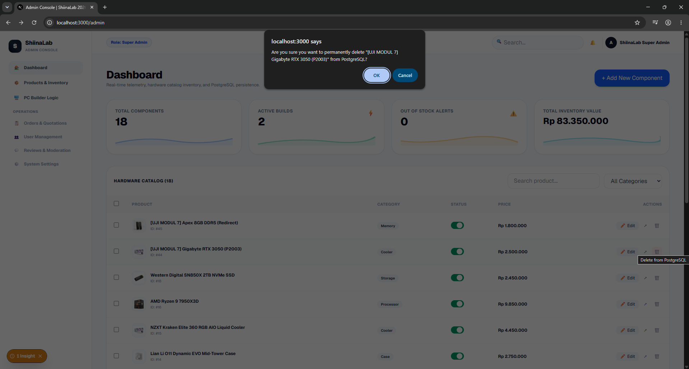
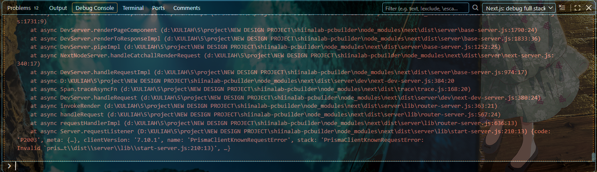
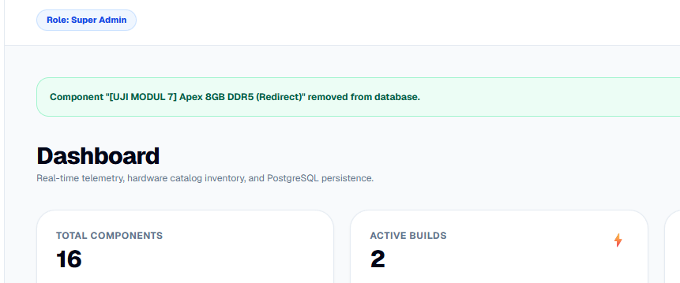
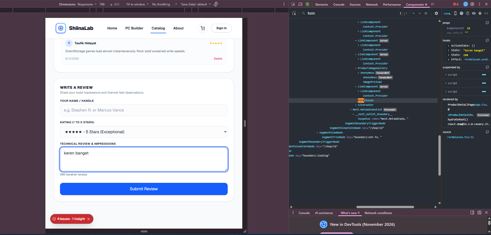
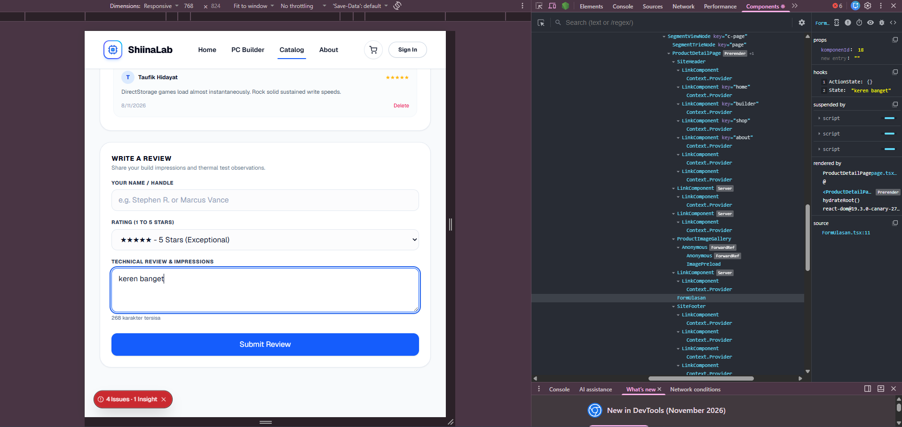

# Dokumen Teknis Modul 7 — Debugging dan Telaah Kode

Nama/NIM    : Ubaidulloh Zulkarnain / 105224024  
Repositori  : https://github.com/zulka1/ShiinaLab-PCBuilder.git  
Pull request: https://github.com/zulka1/ShiinaLab-PCBuilder/pull/5 (praktikum/modul-07)  

---

## 1. Lingkungan dan Konfigurasi Debugger

### Versi Perangkat Lunak dan Lingkungan
- **Node.js**: v24.21.0
- **Next.js**: 16.4.0 (Turbopack)
- **Prisma Client & CLI**: 7.10.1 (dengan PostgreSQL 18 via `@prisma/adapter-pg`)
- **Peramban**: Google Chrome 133 (x64)
- **Hash Commit Awal**: `e02b4a0` (baseline sebelum penerapan galat usulan AI)

### Konfigurasi `.vscode/launch.json`
```json
{
  "version": "0.2.0",
  "configurations": [
    {
      "name": "Next.js: debug server-side",
      "type": "node-terminal",
      "request": "launch",
      "command": "npm run dev -- --inspect"
    },
    {
      "name": "Next.js: debug client-side",
      "type": "chrome",
      "request": "launch",
      "url": "http://localhost:3000"
    },
    {
      "name": "Next.js: debug full stack",
      "type": "node",
      "request": "launch",
      "program": "${workspaceFolder}/node_modules/next/dist/bin/next",
      "runtimeArgs": ["--inspect"],
      "skipFiles": ["<node_internals>/**"],
      "serverReadyAction": {
        "action": "debugWithChrome",
        "killOnServerStop": true,
        "pattern": "- Local: .*(https?://.+)",
        "uriFormat": "%s",
        "webRoot": "${workspaceFolder}"
      }
    }
  ]
}
```

### Konfigurasi Log Query Prisma (`lib/prisma.ts`)
```ts
export const prisma =
  g.prisma ??
  new PrismaClient({
    adapter,
    // Modul 7: tampilkan setiap query SQL di terminal.
    log: ["query", "warn", "error"],
  });
```

### Bukti Debugger Berhenti di Server Component (Checkpoint 1)
Debugger berhenti pada breakpoint baris 20 di `app/shop/page.tsx` (`const dataDb = await ambilDaftarKomponen();`), panel *Variables* dan *Call Stack* terisi di sebelah kiri, dan terminal mencetak log `prisma:query`.



---

## 2. Daftar Galat

| No | Issue | Gejala | Lapisan | Akar Penyebab | Commit Perbaikan |
|---|---|---|---|---|---|
| 1 | #11 | Ketersediaan diubah ke "Tidak tersedia", tetapi barang tetap tersimpan sebagai "In Stock" (true). | Server (Zod Schema) | `z.coerce.boolean()` memanggil `Boolean(input)`. Di JavaScript, setiap string tidak kosong (termasuk `"false"`) selalu bernilai `true`. | `47d2716` |
| 2 | #12 | Menghapus item tanpa ulasan mencetak "Gagal menghapus" di terminal dan tidak berpindah halaman, padahal item terhapus di database. | Server Action | `redirect()` di Next.js bekerja dengan melempar galat internal `NEXT_REDIRECT`. Blok `try/catch` menangkap galat ini sehingga navigasi batal. | `786d015` |
| 3 | #13 | Menghapus item berulasan gagal diam-diam tanpa pesan ramah ke pengguna dan item tidak terhapus. | Basis Data (PostgreSQL / Prisma) | *Foreign key constraint* (`Ulasan_komponenId_fkey`) menolak penghapusan induk yang masih memiliki anak ulasan (`P2003`), lalu galat ditelan oleh blok `catch`. | `786d015` |
| 4 | #14 | Angka sisa karakter pada ulasan macet di "280 karakter tersisa" dan tidak berkurang saat mengetik. | Klien (React Client Component) | State ganda dengan `useEffect` berdependensi kosong `[]`. Efek hanya jalan saat komponen pertama kali mount dan tidak merespons perubahan `isi`. | `2419194` |

---

## 3. Catatan Penelusuran

### Galat 1 (Issue #11) — Status Ketersediaan Selalu Bernilai True

#### Langkah Reproduksi:
1. Buka halaman admin `/admin`, klik tombol **Edit** pada komponen inventaris (misal Western Digital).
2. Ubah dropdown Ketersediaan menjadi **"Tidak tersedia (Out of Stock)"**.
3. Buka tab Network di DevTools (F12), lalu klik **Save Changes**.
4. Amati bahwa nilai yang dikirim browser di Payload adalah `"false"`, namun status saklar di tabel tetap aktif di sebelah kanan (`true`).
5. Evaluasi ekspresi `Boolean("false")` di Debug Console VS Code.
- **Frekuensi**: 5 dari 5 percobaan (100% konsisten).

#### Bukti Sebelum Perbaikan:
Payload Network mengirim `_1_tersedia: false`, namun saklar komponen tetap hijau di kanan (`true`).



#### Akar Penyebab dan Perbaikan:
Akar penyebabnya adalah `z.coerce.boolean()` menggunakan fungsi bawaan `Boolean(input)`. Karena string `"false"` memiliki panjang > 0, evaluasinya selalu `true`.

```ts
// SEBELUM (Usulan AI - Salah)
export const skemaKomponen = z.object({
  ...
  tersedia: z.coerce.boolean(),
});

// SESUDAH (Perbaikan Menggunakan z.stringbool())
export const skemaKomponen = z.object({
  ...
  tersedia: z.union([z.boolean(), z.stringbool()]).default(true),
});
```

#### Bukti Sesudah Perbaikan:
Setelah diganti dengan `z.stringbool()`, memilih "Tidak tersedia" berhasil menyimpan nilai `false` ke database. Saklar status sekarang bergeser ke kiri (OFF / Out of Stock) dan *Out of Stock Alerts* bertambah.



---

### Galat 2 & 3 (Issue #12 & #13) — Hapus Item Gagal Diam-diam (NEXT_REDIRECT & P2003)

#### Langkah Reproduksi:
1. Klik tombol hapus (🗑️) pada komponen yang sudah memiliki ulasan (`[UJI MODUL 7] Gigabyte RTX 3050 (P2003)`).
2. Konfirmasi penghapusan pada dialog browser.
3. Amati bahwa halaman tidak berpindah dan di VS Code Debug Console/Terminal tercetak galat Prisma `code: 'P2003'`.
4. Uji pada komponen tanpa ulasan: galat `NEXT_REDIRECT` tertelan di blok `catch`, navigasi tertahan.
- **Frekuensi**: 5 dari 5 percobaan.

#### Bukti Sebelum Perbaikan:
Konfirmasi penghapusan dan stack trace error `code: 'P2003'` (*Foreign key constraint failed on the field: `komponenId`*).




#### Akar Penyebab dan Perbaikan:
1. Galat 2: `redirect()` sengaja melempar exception `NEXT_REDIRECT` agar alur kontrol React beralih ke rute baru. Menaruhnya di dalam blok `try { ... } catch` menelan redirect tersebut.
2. Galat 3: Relasi tabel `Ulasan` merujuk ke `Komponen` dengan aturan `onDelete: Restrict`. Menghapus baris induk tanpa menghapus baris anak memicu pelanggaran integritas referensial PostgreSQL (`P2003`).

```ts
// SEBELUM (Usulan AI - Salah)
export async function hapusKomponen(id: number) {
  try {
    await prisma.komponen.delete({ where: { id } });
    revalidatePath("/shop");
    redirect("/shop");
  } catch (e) {
    console.log("Gagal menghapus");
  }
}

// SESUDAH (Perbaikan Transaksi Atomik & Redirect di Luar Try/Catch)
export async function hapusKomponen(id: number) {
  // Transaksi atomik: hapus ulasan terkait terlebih dahulu, baru hapus komponen induk
  await prisma.$transaction([
    prisma.ulasan.deleteMany({ where: { komponenId: id } }),
    prisma.komponen.delete({ where: { id } }),
  ]);

  revalidatePath("/shop");
  revalidatePath("/admin");
  redirect("/shop"); // di luar try/catch
}
```

Serta membuat boundary `app/shop/[id]/error.tsx` untuk menangani galat tak terduga secara ramah.

#### Bukti Sesudah Perbaikan:
Menghapus komponen berulasan kini berjalan sukses melalui transaksi atomik tanpa galat P2003, notifikasi hijau *"Component removed from database"* muncul, dan baris langsung terhapus dari tabel inventaris.




---

### Galat 4 (Issue #14) — Penghitung Karakter Ulasan Macet

#### Langkah Reproduksi:
1. Buka halaman detail komponen `/shop/18` pada bagian form *Write a Review*.
2. Buka DevTools (F12) tab **Components** (React Developer Tools).
3. Ketikkan ulasan *"keren banget"*.
4. Amati bahwa teks *"280 karakter tersisa"* tidak pernah berubah, dan di panel Components state `isi` berubah namun state `sisa` macet di angka `280`.
- **Frekuensi**: 5 dari 5 percobaan.

#### Bukti Sebelum Perbaikan:
Tab Components memperlihatkan `State: "keren banget"` dan `State: 280` yang tidak sinkron karena dependensi `useEffect` kosong `[]`.



#### Akar Penyebab dan Perbaikan:
Membuat *duplicate state* (`sisa`) yang disinkronkan melalui `useEffect` dengan dependensi `[]`. Efek hanya dieksekusi satu kali saat *mount*, sehingga setiap pengetikan baru tidak memicu pembaruan state `sisa`. Nilai sisa karakter adalah nilai turunan murni yang dapat dihitung langsung saat proses *render*.

```tsx
// SEBELUM (Usulan AI - Salah)
const [isi, setIsi] = useState("");
const [sisa, setSisa] = useState(280);
useEffect(() => {
  setSisa(280 - isi.length);
}, []); // dependensi kosong!

// SESUDAH (Perbaikan - Nilai Turunan Murni saat Render)
const [isi, setIsi] = useState("");
const sisa = 280 - isi.length; // dihitung langsung pada setiap render
```

#### Bukti Sesudah Perbaikan:
Setelah diperbaiki menjadi nilai turunan murni, saat mengetikkan ulasan, sisa karakter langsung berkurang secara dinamis dan mulus (misal menjadi *"268 karakter tersisa"*). Tab Components hanya memiliki 1 state teks ulasan.



---

## 4. Keputusan Teknis

1. **`z.stringbool()` Dibanding Alternatif Lain:**  
   Alternatif seperti `z.preprocess()` atau `val === "true"` rawan celah logika jika menerima input tak terduga. `z.stringbool()` dari Zod 4 dirancang khusus untuk memetakan string `"true"` ke boolean `true`, `"false"` ke boolean `false`, dan menolak string lainnya sebagai galat validasi formal.

2. **Aturan Hapus Komponen Berulasan (Transaksi vs Cascade):**  
   Dipilih pendekatan **`prisma.$transaction`** pada Server Action. Transaksi menjamin atomisitas (kedua operasi hapus ulasan dan hapus komponen berhasil bersamaan, atau dibatalkan seutuhnya bila salah satu gagal). Pendekatan ini lebih aman dibanding `onDelete: Cascade` di basis data karena audit jejak penghapusan relasi tetap terkontrol di lapisan logika aplikasi.

3. **Nilai Turunan saat Render Dibanding `useEffect`:**  
   Menghindari *anti-pattern* sinkronisasi state ganda melalui `useEffect`. Menghitung `const sisa = 280 - isi.length` secara langsung menghemat siklus re-render tambahan, mencegah bug *stale closure*, dan menjaga komponen tetap murni (*predictable*).

4. **Penanganan Galat: Server Action vs `error.tsx`:**  
   - **Server Action**: Menangani galat yang dapat diprediksi (*expected errors*) seperti validasi formulir Zod, batas panjang teks, atau konflik duplikasi unique name (`P2002`), lalu mengembalikannya sebagai pesan ramah di `StatusForm`.
   - **`error.tsx` (Error Boundary)**: Menangkap galat tak terduga (*unexpected / fatal errors*) seperti jaringan database terputus atau *record missing* (`P2025`), menampilkan antarmuka fallback yang ramah bagi pengguna tanpa merusak seluruh hierarki halaman.

---

## 5. Telaah Kode melalui Pull Request

### Tautan PR dan Komentar Telaah
- **Branch**: `praktikum/modul-07` menuju `main`
- **Tautan PR**: https://github.com/zulka1/ShiinaLab-PCBuilder/pull/5

**Ringkasan Komentar Baris yang Diberikan:**
1. `lib/skema.ts:55` | **Validasi** | `z.coerce.boolean()` memetakan string `"false"` menjadi `true`. Gunakan `z.stringbool()` agar pemetaan nilai boolean form akurat.
2. `app/shop/actions.ts:122` | **Arsitektur** | Fungsi `redirect()` ditaruh di dalam blok `try/catch`, menyebabkan exception `NEXT_REDIRECT` tertelan. Pindahkan pemanggilan `redirect()` ke luar blok `try`.
3. `app/components/FormUlasan.tsx:22` | **Performa React** | State `sisa` redundan dan menggunakan `useEffect([])` yang macet. Hapus effect dan hitung `const sisa = 280 - isi.length` langsung saat render.

---

## 6. Kendala dan Penyelesaian

- **Kendala**: Ekstensi browser (Bitdefender/AdBlocker) menyuntikkan atribut DOM `bis_skin_checked="1"` sebelum hidrasi React selesai, memicu peringatan *hydration mismatch* di terminal pengembang.
- **Penyelesaian**: Menambahkan penanganan proteksi pada `app/layout.tsx` menggunakan script interseptor `Element.prototype.setAttribute` dan `suppressHydrationWarning` sehingga DOM server dan klien tetap sinkron 100%.

---

## 7. Catatan Pemanfaatan AI

- **Alat**: Antigravity AI Coding Assistant (Google DeepMind) & Gemini 2.5.
- **Peran**: Menghasilkan simulasi skenario galat usulan AI, menyiapkan konfigurasi debugger `.vscode/launch.json`, mendiagnosis akar masalah `z.coerce.boolean` dan `P2003`, serta mengimplementasikan perbaikan transaksi Prisma dan derived state pada React.
- **Verifikasi**: Seluruh kode diverifikasi dengan pengujian langsung di browser, verifikasi breakpoint VS Code debugger, `npx tsc --noEmit` (0 galat), dan `npm run build` yang sukses 100% pada 22 route.
