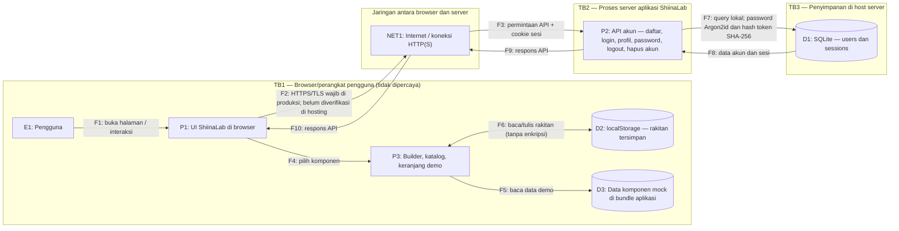

# DFD ShiinaLab — PC Builder & Parts Store (`sec-0.1`)

Diagram ini menunjukkan versi yang berjalan sekarang, bukan rancangan toko online di masa depan. `TB1`, `TB2`, dan `TB3` menandai trust boundary: data perlu dianggap lebih berisiko saat melintasinya.

## Cara membaca batas dan perlindungannya

- **TB1** memisahkan perangkat pengguna dari sistem lain. Pengguna mengendalikan browser dan isi `localStorage`; jangan menganggap data di sana tepercaya.
- **TB2** memisahkan browser/jaringan publik dari API server. Anggap input dan permintaan yang datang dari browser bisa dimanipulasi. HTTPS/TLS harus dipastikan saat aplikasi dipasang untuk produksi; diagram tidak mengklaim koneksi pengembangan lokal sudah terenkripsi.
- **TB3** memisahkan proses aplikasi dari file database di host. Proses API memakai SQLite lokal, tetapi pengguna OS atau pihak yang mendapat akses ke file masih dapat membaca database karena enkripsi saat tersimpan belum diterapkan aplikasi.
- **Penanda kriptografi:** password di D1 dilindungi dengan hash Argon2id; token sesi mentah disimpan sebagai cookie `HttpOnly` (serta `Secure` di produksi), sementara D1 menyimpan hash SHA-256 token. Keduanya bukan enkripsi database.
- **Belum dilindungi dengan enkripsi oleh aplikasi:** data profil di D1 dan rakitan di D2. Jangan menyimpan password atau data sensitif di D2.

## Elemen

| ID | Jenis | Keterangan |
|---|---|---|
| E1 | Entitas eksternal | Pengguna ShiinaLab melalui browser. |
| P1 | Proses klien | Halaman dan formulir yang tampil di browser, termasuk formulir akun. |
| P2 | Proses server | Route API Next.js untuk akun dan autentikasi. |
| P3 | Proses klien | Builder dan katalog demo; pemeriksaan kompatibilitas dasar berjalan di browser. |
| D1 | Penyimpanan server | SQLite berisi akun, hash password, profil, serta sesi. |
| D2 | Penyimpanan klien | `localStorage` berisi rakitan demo; bukan penyimpanan akun. |
| D3 | Data aplikasi | Katalog komponen mock yang dikirim bersama aplikasi. |
| NET1 | Jaringan | Jalur browser-server; TLS di produksi merupakan kebutuhan deployment. |

## Alur

| ID | Dari → ke | Data |
|---|---|---|
| F1 | E1 → P1 | Membuka halaman, mengirim input formulir, dan berinteraksi dengan aplikasi. |
| F2 | P1 → NET1 | Permintaan halaman/API dari browser; lindungi dengan HTTPS/TLS di produksi. |
| F3 | NET1 → P2 | Permintaan API akun dan, setelah login, cookie sesi. |
| F4 | P1 → P3 | Pilihan komponen dan masukan builder. |
| F5 | P3 → D3 | Membaca data komponen demonstrasi. |
| F6 | P3 ↔ D2 | Menyimpan atau membaca rakitan pada browser; data bisa diubah oleh pemilik perangkat atau skrip di origin yang sama. |
| F7 | P2 ↔ D1 | Query SQLite untuk akun/sesi; password tersimpan sebagai hash Argon2id dan token sesi sebagai hash SHA-256. |
| F8 | D1 → P2 | Data profil atau status sesi yang dibutuhkan API. |
| F9–F10 | P2 → NET1 → P1 | Hasil permintaan API kembali ke browser. |
